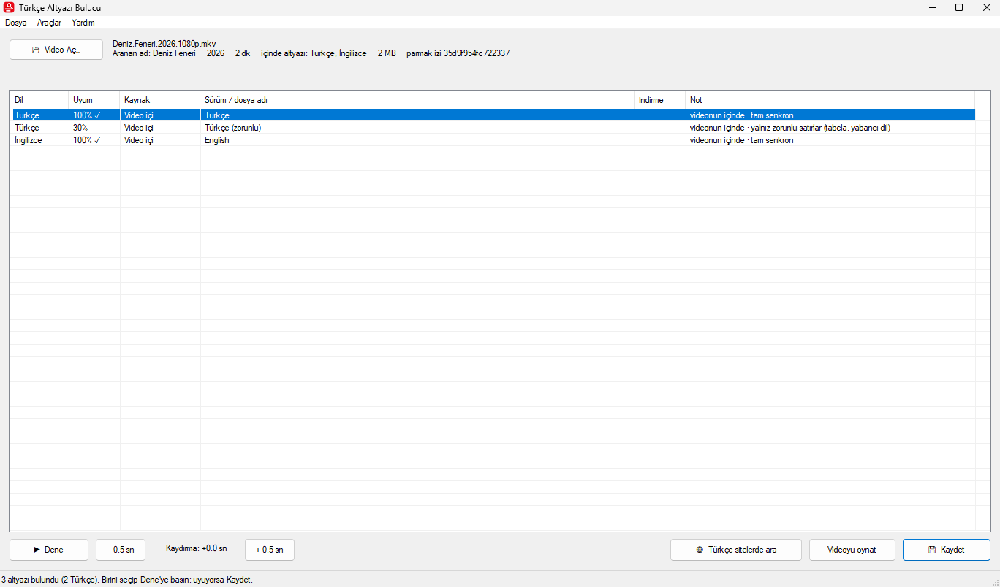
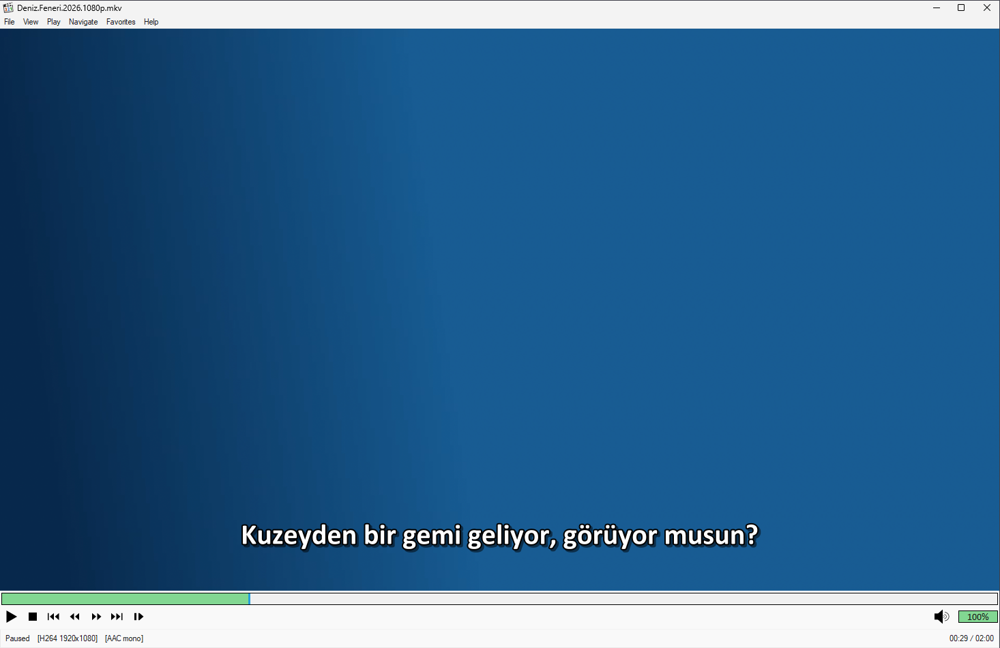

# Türkçe Altyazı Bulucu

Videonuzu sürükleyin, uygun Türkçe altyazı saniyeler içinde gelsin.

Film ya da dizi dosyanıza uyan altyazıyı birkaç kaynakta aynı anda arar, her sonuca bir uyum puanı verir ve en uygununu en üste koyar. **Dene** düğmesi videoyu konuşma olan bir anda altyazıyla açar; oturup oturmadığını kendi gözünüzle görürsünüz. Beğendiğinizde **Kaydet** ile altyazı videonun yanına kaydedilir, oynatıcınız onu kendiliğinden açar.



## İndir

**[TurkceAltyaziBulucu-Kurulum.exe](../../releases/latest)** — Windows 10/11, 64 bit.

Kurulum Windows yönetici izni istemez; program kullanıcı klasörüne kurulur. İmzasız olduğu için Windows "bilgisayarınızı korudu" uyarısı gösterebilir: **Ek bilgi → Yine de çalıştır**.

## Neler yapar

- **Parmak iziyle arama:** tam bu dosya için yüklenmiş altyazılar ✓ işaretiyle en üstte.
- **Video içindeki altyazılar:** MKV dosyalarındaki Türkçe izleri bulup çıkarır; yalnız tabela çevirisi içeren "zorunlu" izleri ayrıca işaretler.
- **Bozuk Türkçe karakterleri tanır** (ş, ğ, ı eksik) ve sıralamada aşağı iter.
- **Dene + kaydırma:** altyazıyı videoda dener, ±0,5 saniye kaydırıp yeniden denersiniz.
- **Sağ tık menüsü:** Dosya Gezgini'nde videoya sağ tıklayıp "Türkçe altyazı bul".
- **Dahili oynatıcı:** deneme için MPC-HC içinde gelir, ek kodek gerekmez.
- Türkçe yoksa İngilizce altyazıları da listeler (isteğe bağlı); Türkçe altyazı sitelerinde tek tıkla arama.
- Hesap, API anahtarı ya da ayar gerekmez. Reklam yok, kişisel veri toplanmaz ([gizlilik](paket/magaza/gizlilik.html)).



Kaynaklar: BSPlayer (varsayılan), isteğe bağlı OpenSubtitles.com ve Subdl (kendi hesabınız/anahtarınızla, Ayarlar'dan).

## Derleme (Linux'tan çapraz derleme)

```
./derle.sh          # MinGW-w64 → yapi/TurkceAltyaziBulucu.exe, TabMenu.dll, TurkceAltyaziBulucu-Kurulum.exe
./paketle.sh        # Microsoft Store paketi (MSIX); ayrıntı: paket/magaza/REHBER.md
```

Gerekenler: `x86_64-w64-mingw32-g++`, `windres`. Kaynak kod C++17, Win32 API; dış bağımlılıklar `ucuncu/` klasöründe.

## Sorun bildir

Programdaki **Yardım → Sorun bildir** teşhis bilgisini panoya kopyalar ve buradaki [Issues](../../issues) sayfasını açar.

## Lisans

Program kodu [MIT](LICENSE). İçinde gelen MPC-HC ve LAV Filters GPL-2.0 lisanslıdır; ayrıntılar kurulumla gelen `LISANSLAR.txt` dosyasında. Altyazılar ilgili servislerin kullanıcılarına aittir; bu program yalnızca arar ve indirir.
